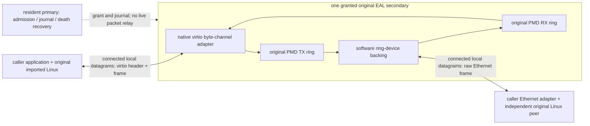

# 原始 Linux 与 resident packet session

`ker-session serve/run --paired-pmd` 将实际 EAL secondary 接到原始 imported
Linux 实例。此模式使用原始 `rte_eth_from_rings` 创建一个 network port，RX/TX
分别连接两个固定、独立的原始 DPDK ring。它与 `--ring-pmd` 的单 ring loopback
诊断不同；实际外部 Linux 对端通过调用方提供的 Ethernet endpoint 参与收发。



software-device backing 与 PMD consumer 同属一个获授权 secondary。原始 ring
PMD 的 TX dequeue 表示 backing 已取得对象；成功复制到外部 endpoint 后该
对象才能再次使用。反向由 backing 把完整外部 Ethernet 帧放入原始 RX ring，
consumer 用原始 `rte_eth_rx_burst` 取得它，再复制到既有 Linux virtio channel。
这里不解析或合成 TCP/UDP/ARP 状态、ACK、重传或分段；它们由两侧原始 Linux
实现。resident 只处理控制与进程死亡回收，不永久代理数据包。

## 使用与明确边界

在已有共享 hugepage 环境中启动 resident，保持 stdin 打开。`SESSION_DIR` 必须
是当前用户的私有目录，`SHARED_EAL_OPTIONS` 应使用相同 file prefix、hugetlbfs、
兼容 CPU/内存配置。工具控制 `--proc-type`，拒绝任意设备与 PCI allow 参数。
本模式需要原始 net_ring PMD；CMake 直接链接其公开 API，不动态猜测符号。

```sh
ker-session serve --socket "$SESSION_DIR/control.sock" --paired-pmd \
  --eal "$SHARED_EAL_OPTIONS"
ker-session run --socket "$SESSION_DIR/control.sock" --paired-pmd \
  --eal "$SHARED_EAL_OPTIONS" --wire-fd "$ETHERNET_FD" \
  --library /path/to/libker-posix.so --address 198.18.0.2/24 \
  --address6 2001:db8:1::2/64 --stats /path/to/session-stats.json \
  -- /path/to/caller-application arguments
```

`ETHERNET_FD` 是已连接的本地 AF_UNIX/SOCK_DGRAM endpoint，每条记录只包含一个
完整 Ethernet 帧。调用方负责另一端与真实 wire/TAP/其他 Ethernet 设施连接，
并在转交后关闭自己不再需要的 fd 副本。工具不创建或修改调用方的 host 网络。
原始 Linux 与 worker 之间另有私有 packet/MTU channel，业务应用不取得 wire fd。
默认 IPv4 为198.18.0.2/24，IPv6仅在显式指定时启用；网络/广播/映射等不支持的
endpoint 会明确拒绝。此版本 kernel-interface MAC 固定为02:4b:45:52:00:02，
适用于独立软件 Ethernet link，尚不提供物理 NIC/MAC 配置或共享链路部署保证。

应用 stdin/stdout 原样继承；诊断在 stderr，显式 `--stats` 原子保存启动、worker、
原始 PMD 与 native Linux 计数和结果。应用本身仍是调用者提供的程序。
launcher 先完成实际 EAL lookup、消费者 grant 和 packet readiness，再在应用
spawn 前重新检查 worker。普通应用退出触发既有原始 Linux teardown，随后
停止并回收 worker、释放 epoch；worker 提前丢失返回125，不能伪报业务成功。
本 profile 未设置 callback-run 的 `KER_RUN_FD`，不声明支持 `ker_posix_run` 的
supervisor ACK；需要该 ABI 的调用者仍应使用既有 `ker-run` 路径。

当前固定 MTU1500、单 RX/TX queue、单段原始 mbuf、无协商 TX offload。MTU GET
从原始 PMD 读取并核对，非1500的 SET 明确返回 EOPNOTSUPP，由原始 Linux ioctl
适配事务恢复其旧 MTU。GSO/checksum-partial 等未协商 metadata、短帧或超界
记录会明确失败。背压时保留完整帧与原对象，每方向最多一个 in-flight 对象，
不重排、不丢弃后再假装发送成功；不提供吞吐或硬件能力声明。

## 对象与进程寿命

resident 在 grant ACK 前分配并记录三个不同原始对象：control、TX、RX。共享
目录 ABI 为5。secondary 不把这些对象归还 pool；它们在私有 journal 和原子
lease 下复用。native application 和外部 peer 只取得字节副本，不借用 EAL
指针，故 exact worker pidfd 死亡才能证明所有借用对象的进程访问已停止。

resident 随后检查原始 RX/TX 队列中的指针，拒绝 foreign/duplicate 引用，核对
pool、单段、refcount 与共享 lease，再恰好一次归还其私有记录。空队列不表示
对象没有被借用：copy 前、enqueue 前、dequeue 后或阻塞发送时死亡，都不能
仅凭队列为空跳过 journal。正常退出的 retained 记录可能包含待回收的最后一帧；
只有 worker 死亡并完成 resident 回收后的 pool census 才证明对象全部归还。
当前软件 backing 没有独立 EAL 指针借用者；物理 NIC 的异步 DMA/driver 引用
需要另外的所有权与停止证明，不能套用这个 profile 的结论。

## 执行证据与源用例范围

`native-fstack-session-native-packets` 在私有网络 namespace 中建立原始 Linux
TAP peer，向获授权 secondary 转交完整帧，执行实际 imported-Linux TCP4097/
UDP512 IPv4/IPv6 服务。独立 host socket 要求完整字节、对端与 EOF；Ethernet
捕获要求两个方向、两种 IP、TCP/UDP 均存在。原始 PMD 计数须与实际 burst
一致，native Linux passive-open/UDP 计数须增长、native buffers须清零。

负例使用另一个真实 EAL secondary 请求已占用的设备，并跟踪真实 process
creation，要求业务 guard 从未启动；测试 wrapper 转发真实操作，不生成成功
mock。另在公开 worker-ready stats 写入后，用实际 pidfd 杀死该 worker，要求
spawn 前发现死亡。最后在真实 native app 已启动后杀死其 worker，要求125和
全部511对象回收。无原始 Linux/DPDK source 修改。宿主缺少共享 hugepages 时
CTest跳过77，不能算作运行时通过；隔离 guest 执行完整运行时验收。

源 TC-1 `test_it_a14_primary_precreates_all_slots` 在本批完成场景适配：primary
在接纳任何 secondary 前，用原始 rte_ring_lookup 验证全部128个坐标对象、
容量和SP/SC几何；配置1个原始端口和固定 epoch-independent queues，保持
resident epoch/slot0。实际 secondary 再验证全部128对象，并使用该端口收发。
这不声明 F-Stack ring-name/FreeBSD ABI，也不声明完整 reload dispatcher。

已完成单消费者 kernel packet delivery；cross-generation dispatch/drain、
exception/KNI-owner 协调、排队中 driver 故障
注入、物理设备和完整应用 reload 仍在 #218 下继续跟踪。不能把普通程序重启
当作保留旧 TCP 连接的 graceful reload。

## 保持真实连接的待机接管

`ker-session run --paired-pmd --standby` 会让被拒绝的真实 EAL secondary 保持
连接。它只借用自己的 control 对象，不访问 PMD 数据队列，也不启动 native
应用。supervisor 以一问一答的控制请求重试 admission；每次只有一个未完成
请求，避免取得授权后遗留的控制字节误停 packet loop。`--stats` 在等待期间
报告 `stage=standby`、`app_started=false` 和实际 worker 身份。

resident 仍只在原持有者 exact pidfd 死亡、队列回收并检查 journal 后转交授权。
取得授权的仍是同一 PID、EAL attachment、epoch 和 slot；它随后验证两个
数据 lease、进入原始 PMD 收发循环，supervisor 才启动 original Linux 应用。
standby 等待没有累计 admission 超时；每次控制请求仍有超时和 resident 死亡
检查，用户中断会回收待机进程。实际排队取消分别覆盖 SIGINT 状态130 和 SIGTERM 状态143；后者要求 worker0、无 packet completion、未启动应用、exact pidfd 死亡、control lease 回收且原消费者 census 不变。未指定 `--standby` 的忙设备仍返回125。

运行时验收让两个不同 master/secondary 同时存活，观察至少五次 busy 结果，
确认待机没有创建 `ker-app`，仅多占一个 control 对象，resident 的实际设备
owner 仍为原持有者。原应用完成并退出后，待机的同一 PID/EAL/epoch 取得
授权，再执行独立 host 对 original Linux 的 IPv4/IPv6 TCP4097、UDP512
收发和 MTU 回滚；第二次退出后要求全部511原始对象归还。

这是完整应用退出后的设备接管，不保证旧 TCP 连接延续。源 TC-3 仍为 partial：
跨代 dispatch/drain 和实际 exception-owner 路由/授权一致性尚未覆盖，不能用
PMD admission 数值替代 source KNI-owner 契约。
